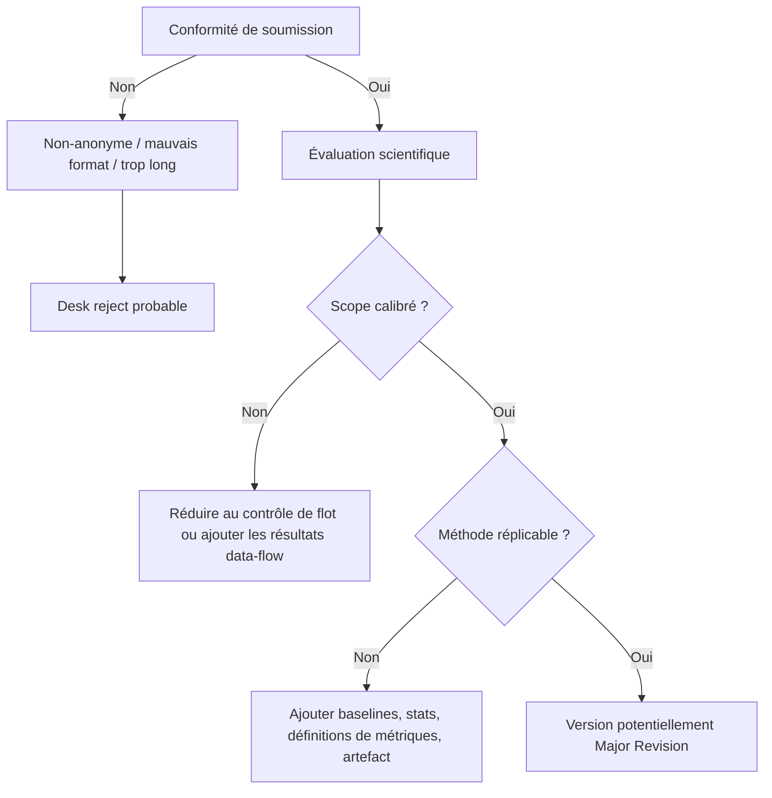

# Revue critique détaillée du manuscrit ICSE

## Résumé exécutif

Ce manuscrit traite d’un sujet clairement dans le périmètre d’ICSE 2027 : l’évaluation des LLMs pour le génie logiciel, la compréhension de programmes, l’analyse de programmes, et des métriques d’efficacité au-delà de l’exactitude finale sont explicitement au cœur de l’appel à contributions 2027. Le problème visé est donc pertinent, et l’intuition centrale du papier — qu’une réponse booléenne correcte peut masquer un raisonnement de programme défectueux — est intéressante et potentiellement utile pour la communauté IA-pour-le-génie-logiciel. citeturn13view0turn13view1turn13view2turn10view0

En revanche, **tel que ce PDF est présenté**, je vois d’abord un problème administratif majeur avant même l’évaluation scientifique. La page de garde affiche le nom de entity["people","Nolan Bizon","software engineering author"] et l’affiliation entity["organization","LaBRI","bordeaux, france"], alors que le research track ICSE 2027 impose une évaluation **double-anonyme** et stipule explicitement que les noms des auteurs doivent être omis. De plus, ICSE 2027 exige cette année le **template IEEE**, alors que le PDF est visiblement en style entity["organization","ACM","computing association"]/acmart plutôt qu’en style entity["organization","IEEE","professional association"] conference proceedings. Enfin, le texte principal du manuscrit court jusqu’à la page 14, les références ne commençant qu’à la page 15, ce qui dépasse nettement la limite de 10 pages de texte principal autorisée pour ICSE 2027. Si ce PDF correspond réellement au fichier soumis, il y a un **risque sérieux de desk reject administratif**. fileciteturn0file0 citeturn10view0turn11view0turn11view4

Sur le fond, je considère que l’idée de benchmark a du potentiel, mais que la version actuelle n’est pas encore au niveau attendu pour un paper de recherche ICSE. Les points les plus problématiques sont : un **sur-encadrement du scope** (le titre et plusieurs formulations annoncent « control and data flow » alors que seuls des résultats contrôle-de-flot sont effectivement rapportés) ; une **sous-spécification méthodologique** de l’évaluateur, des métriques de trace et des cas négatifs ; l’absence de **baselines indispensables** et de **validation statistique** sérieuse ; une **reproductibilité insuffisante** alors qu’ICSE 2027 demande au minimum un accès artefact au PC ou une justification du non-partage ; et un **état de l’art trop mince** pour un papier de ce type. Ma recommandation scientifique, indépendamment du volet administratif, est donc **Reject** dans le cadre ICSE 2027, avec le jugement qu’une version fortement révisée pourrait devenir un **Major Revision** crédible. fileciteturn0file0 citeturn10view0turn11view2turn11view3turn12view0

## Diagnostic global

J’évalue le manuscrit au regard des cinq critères officiels du research track ICSE 2027 : **Novelty, Rigor, Relevance, Verifiability and Transparency, Presentation**. citeturn10view0

| Critère ICSE 2027 | Appréciation | Diagnostic |
|---|---|---|
| Novelty | Moyenne | L’idée « accuracy final vs path fidelity » est intéressante, mais le papier ne positionne pas assez précisément sa nouveauté face aux benchmarks récents LLM-for-code / program comprehension. |
| Rigor | Faible | Oracles négatifs et métriques de trace insuffisamment formalisés; détails d’inférence incomplets; pas de baselines classiques; pas d’inférence statistique. |
| Relevance | Bonne | Sujet clairement pertinent pour ICSE 2027. |
| Verifiability & Transparency | Faible | Pas d’artefact accessible indiqué dans le papier; paramètres et scripts insuffisamment décrits; la conclusion parle d’une diffusion future, pas d’une disponibilité présente. |
| Presentation | Mitigée | Le style prose est globalement propre, mais la structure est redondante, l’article est trop long, non anonyme, et formellement non conforme. |

Le public naturel est celui des chercheurs en IA pour le génie logiciel, benchmark design, program comprehension et analysis/testing. Pour une audience ICSE large, le papier gagnerait beaucoup à relier son benchmark synthétique à des tâches plus proches de dépôts réels, ou à au moins une validation externe sur code réel. Sans cette passerelle, la contribution reste utile mais étroite pour un flagship paper. fileciteturn0file0 citeturn13view0turn13view1turn13view2

## Problèmes majeurs

Les repères page/ligne ci-dessous se fondent sur les numéros de lignes visibles dans le PDF. Le tableau suivant synthétise les problèmes les plus importants observables directement dans le manuscrit, en les reliant aux attentes explicites d’ICSE 2027 et de l’évaluation d’artefacts. fileciteturn0file0 citeturn10view0turn11view0turn11view2turn12view0

| Priorité | Problème | Où le voir | Pourquoi c’est bloquant | Correctif concret |
|---|---|---|---|---|
| Critique | Non-conformité administrative | p.1 l.1–8; texte principal jusqu’à p.14; refs p.15 | Double-anonymat violé; mauvais template; dépassement clair de longueur | Recomposer en IEEE 2027, anonymiser totalement, ramener le texte principal à 10 pages maximum |
| Critique | Scope sur-annoncé par rapport aux résultats | titre; résumé p.1 l.10–36; contributions p.2 l.123–137; conclusion p.14 l.1610–1623 | Le papier promet « control and data flow », mais seul le contrôle de flot est évalué quantitativement | Soit ajouter une vraie section résultats data-flow, soit re-scoper titre/résumé/contributions au contrôle de flot |
| Critique | Définition incomplète des métriques et des oracles | §3.1; §5.3; p.14 l.1523–1542 | Sans définition rigoureuse des traces négatives et du scoring, la validité de « chain/trace accuracy » reste contestable | Formaliser mathématiquement les métriques et expliciter la politique pour les cas négatifs |
| Critique | Pas de baselines indispensables | §5–§6; Tables 7–17 | Aucun baseline parseur/statique, heuristique, ni modèle sans mode reasoning; difficulté réelle du benchmark difficile à situer | Ajouter au minimum un baseline statique parfait, un baseline heuristique, et un baseline LLM sans budget reasoning |
| Majeur | Comparabilité du “reasoning budget” insuffisamment établie | §5.2–§5.4; p.10 Tables 9–11 | Les budgets demandés ne sont pas nécessairement sémantiquement comparables entre modèles/serving stacks | Décrire précisément le mapping budget→API par modèle et limiter les claims à un effet “interface-level” |
| Majeur | Validation statistique insuffisante | §5.4; p.13 Table 17; p.14 l.1557–1565 | Le papier rapporte des deltas et contrastes descriptifs, mais pas de CIs, pas de tests, pas de modèle factoriel ajusté | Ajouter ICs bootstrap 95%, tailles d’effet, et un modèle logistique/mixte avec interactions principales |
| Majeur | Transparence / reproductibilité insuffisantes | p.14 l.1528–1531; p.14 l.1620–1623 | Le papier reconnaît lui-même qu’un audit manuel devrait être ajouté, et parle d’un release futur des artefacts | Fournir un artefact anonymisé au PC avec générateur, seeds, prompts, sorties brutes, parseur, scripts et README |
| Majeur | Related work trop limité | p.2 §2; p.14 §9; p.15 refs [1]–[11] | 11 références seulement pour un benchmark paper ICSE est insuffisant; omissions évidentes côté benchmarks récents, modèles, tooling et évaluation | Étendre fortement l’état de l’art, y compris modèles évalués, vLLM, benchmarks LLM-for-code récents et travaux sur faithful reasoning |
| Majeur | Mauvaise allocation de l’espace | p.4–6 vs p.6–7 | Beaucoup d’espace sur la dérivation élémentaire du paramètre \(p\), trop peu sur parseur, prompts, seeds, audit, statistiques | Réduire les dérivations simples et déplacer plusieurs tableaux/annexes vers artefact/supplément |

Le point le plus grave, à mon avis, est la **conformité de soumission**. ICSE 2027 demande explicitement le template IEEE, 10 pages de texte principal, et un processus double-anonyme avec omission des noms d’auteurs; le manuscrit visible ici viole les trois contraintes à la fois. Même si le papier était scientifiquement plus mûr, cela resterait un problème majeur pour un reviewer/AC. fileciteturn0file0 citeturn10view0turn11view0turn11view4

Sur le fond, le second point le plus lourd est le **décalage entre ce que le papier annonce et ce qu’il démontre effectivement**. Le titre, les mots-clés, le pitch général et la conclusion donnent l’impression d’une étude conjointe control-flow/data-flow, alors que le papier dit lui-même que les résultats quantifiés rapportés sont ceux du contrôle de flot, et que le data flow est seulement “specified/planned”. Pour un reviewer, cela apparaît comme une promesse non tenue plutôt qu’une simple limitation. fileciteturn0file0

Le troisième point majeur est la **fragilité conceptuelle de l’évaluation des traces**. Pour les cas positifs, un oracle de chemin exact est naturel. Pour les cas négatifs, en revanche, un “expected explored path” dépend d’une stratégie de parcours, donc n’est pas unique sans convention explicite et strictement documentée. Or le papier rend ces choix visibles seulement de façon allusive, tout en bâtissant une partie importante de ses claims sur exact-chain accuracy et trace accuracy. Ce problème est aggravé par le fait que les auteurs reconnaissent eux-mêmes qu’un audit manuel de sorties parsées devrait encore être ajouté en version finale. fileciteturn0file0

Enfin, le papier ne satisfait pas encore ce qu’ICSE 2027 appelle **verifiability and transparency**. Les critères officiels demandent assez d’information pour comprendre comment l’innovation fonctionne, comment les données ont été obtenues et analysées, et comment vérifier ou répliquer les résultats; la politique open science 2027 ajoute que le partage d’artefacts est la valeur par défaut, ou qu’un non-partage doit être justifié. Ici, je ne vois ni lien ni statement d’accès artefact dans le papier, et la conclusion parle d’un release futur plutôt que d’une disponibilité actuelle. fileciteturn0file0 citeturn10view0turn11view2turn11view3turn12view0

## Problèmes mineurs

Les points ci-dessous ne sont pas, isolément, des motifs de rejet; ensemble, ils dégradent toutefois la lisibilité, la crédibilité et la maturité perçue du manuscrit. fileciteturn0file0

| Gravité | Problème | Exemple | Suggestion |
|---|---|---|---|
| Moyenne | RQ0 n’est pas vraiment une question de recherche | p.1–2, RQ0 = “How can we generate…” | Reformuler en question évaluative, ou intégrer RQ0 dans la section design plutôt que résultats |
| Moyenne | Terminologie parfois flottante | “trace”, “chain”, “path”, “reasoning chain”, “emitted reasoning” | Ajouter un encadré de définitions et unifier strictement les termes |
| Moyenne | Facteurs exposés mais sous-analysés | graph family, linear/tree, stressors, etc. introduits mais peu exploités dans les résultats | Ajouter une analyse dédiée par graph family et par label positif/négatif |
| Moyenne | Figure 1 et plusieurs graphiques reposent beaucoup sur la couleur | bleu/rouge pour reachable/unreachable; figures 6–9 | Ajouter styles de lignes, motifs, marqueurs et annotations textuelles compatibles impression N&B |
| Moyenne | Figure 7 et plusieurs tableaux sont trop denses | heatmap p.10; tables p.11–13 | Agrandir, simplifier, ou déplacer au supplément; garder dans le main text seulement les visuels les plus informatifs |
| Moyenne | Table 17 est peu autoportante | “stress-minus-baseline deltas”; “if: 1 -> 2” | Définir précisément la baseline et la méthode de calcul dans la caption ou le texte |
| Moyenne | Related work redondant avec background | Sections 2 et 9 couvrent partiellement le même terrain | Fusionner/compresser pour libérer de la place |
| Faible à moyenne | Pas de statement explicite sur licences, coûts de calcul, contraintes d’usage des modèles | §5.2 et Conclusion | Ajouter un court paragraphe éthique/openness même sans sujets humains |
| Faible à moyenne | Peu d’exemples qualitatifs détaillés | Table 16 seul exemple concret marquant | Ajouter 2–3 études de cas contrastives (cas positif, négatif, erreur de branche) |
| Faible | Quelques tableaux semblent plus implémentationnels que scientifiques | “CSV rows”, token rows | Déplacer vers artefact/supplément |

La rédaction elle-même est **globalement solide** : l’anglais est lisible, les captions sont souvent informatives, et le fil argumentatif principal se comprend bien. Le problème n’est donc pas une faiblesse linguistique majeure, mais plutôt une combinaison de **sur-longueur, redondance, et sous-spécification des détails qui comptent le plus scientifiquement**. fileciteturn0file0

## Révisions concrètes et formulations proposées

L’ordre de révision que je recommande est le suivant : **conformité**, **re-scoping du message**, **solidification méthodologique**, **reproductibilité**, puis **resserrage rédactionnel**. C’est aussi l’ordre qui maximise les chances qu’une prochaine version réponde réellement aux critères ICSE 2027 de novelty, rigor, relevance, verifiability/transparency et presentation. citeturn10view0turn11view2turn12view0

| Emplacement | Ce qui ne va pas | Proposition de remplacement exacte |
|---|---|---|
| Titre | Le titre sur-annonce “Program Control and Data Flow” sans résultats data-flow complets | **Option A**: *Reasoning Under Budget: Benchmarking Large Language Models on Java Control-Flow Reachability*  **Option B**: *ReachabilityBench: Benchmarking Budgeted LLM Reasoning on Java Control Flow* |
| Résumé, ouverture | Le résumé mélange benchmark design et résultats empiriques d’une famille encore non évaluée | **Proposition (EN)**: “We introduce ReachabilityBench, a controlled Java benchmark for program-flow reasoning. This paper reports a completed control-flow study and specifies, but does not yet empirically evaluate, a paired data-flow task family. We evaluate three reasoning-capable models on generated control-flow reachability tasks and compare final-answer accuracy against path-level metrics.” |
| Contributions | Les contributions laissent croire que les deux familles sont empiriquement à niveau égal | **Proposition (EN)**: “A controlled benchmark design for Java program-flow reasoning, consisting of a fully evaluated control-flow family and a formally specified paired data-flow extension.” |
| Section Méthodologie / settings | Manque de paramètres exacts d’inférence, de versions, de seeds, de description matérielle | **Paragraphe à insérer (EN)**: “For each model, we report the exact checkpoint identifier, quantization setting, context window, hardware configuration, serving software version, decoding parameters (temperature, top-p, seed, stop sequences), maximum output length, and the exact mapping from the requested budget parameter to the serving API. Unless otherwise stated, all runs use deterministic decoding and a single fixed seed.” |
| Section Métriques | Les métriques de trace ne sont pas assez formelles, surtout pour les cas négatifs | **Paragraphe à insérer (EN)**: “For reachable instances, exact-chain accuracy is 1 iff the predicted trace exactly matches the oracle source-to-target path. For unreachable instances, we define a canonical traversal order used by the oracle and evaluate both (i) order-sensitive exact-chain accuracy under this convention and (ii) order-insensitive coverage metrics. We report the full formal definitions of all metrics below.” |
| Threats / limitation budget | Le papier parle de reasoning budget, mais ne mesure pas réellement la consommation interne | **Remplacement (EN)**: “Requested reasoning budget should be interpreted as an interface-level control rather than a direct measurement of internally consumed reasoning tokens. Accordingly, our conclusions concern the behavior of specific model-interface pairs under requested budgets, not latent reasoning cost.” |
| Reproductibilité | La conclusion promet une release future au lieu de documenter une disponibilité présente | **Paragraphe à insérer (EN)**: “An anonymized replication package accompanies this submission. It contains the generator, prompt templates, configuration files, seeds, raw model outputs, parsing scripts, evaluation scripts, and figure/table generation scripts, together with a containerized environment and a README that reproduces the main results.” |
| Éthique / openness | Pas de statement explicite | **Paragraphe à insérer (EN)**: “This study does not involve human participants. We evaluate publicly available models and generated Java programs. To support transparency and reproducibility, we provide anonymized artifacts, document all software dependencies and hardware requirements, and disclose any constraints that may limit public release upon acceptance.” |

Je recommande aussi des **changements structurels exacts** pour rentrer dans la limite de 10 pages de texte principal et améliorer le focus scientifique :  
1. fusionner les sections 2 et 9 en une seule section “Background and Related Work” beaucoup plus courte ;  
2. déplacer les dérivations élémentaires sur \(p\) et certaines figures illustratives vers le supplément/artefact ;  
3. garder en texte principal seulement un tableau de résultats globaux, un tableau difficulté/context-depth, une figure de scaling, et un tableau de failure taxonomy ;  
4. déplacer Tables 9–11 et une partie de 14–17 vers le supplément ;  
5. utiliser l’espace gagné pour une vraie sous-section “Evaluator, Parsing, and Statistical Analysis”. fileciteturn0file0

Si je devais résumer la réécriture en une phrase : **réduire la rhétorique et augmenter la spécification**. Le papier doit moins “vendre” une vision control+data-flow déjà accomplie, et davantage “prouver” un protocole contrôle-de-flot rigoureux, réplicable et justement calibré. fileciteturn0file0

## Checklist de resoumission

La checklist suivante est celle que j’attendrais avant de considérer une nouvelle version comme sérieusement compétitive pour ICSE 2027. Elle combine contraintes research track, open science policy et attentes artefact evaluation. citeturn10view0turn11view2turn11view3turn12view0

- [ ] Repasser **entièrement** le papier en format IEEE ICSE 2027.  
- [ ] Retirer tout identifiant auteur/affiliation et vérifier le double-anonymat sur l’ensemble du PDF.  
- [ ] Ramener le **texte principal** à 10 pages maximum.  
- [ ] Re-scoper le titre, le résumé, les contributions et la conclusion pour refléter **exactement** ce qui est évalué.  
- [ ] Soit ajouter une évaluation data-flow complète, soit retirer toute ambiguïté laissant croire qu’elle est déjà faite.  
- [ ] Ajouter une table complète de composition du benchmark : nombre d’instances par contexte, profondeur, graph family, label, stressor, et split.  
- [ ] Décrire précisément le générateur : sampling, seeds, dé-duplication, parcours oracle, politique des cas négatifs.  
- [ ] Décrire précisément les modèles : versions/checkpoints, citations des modèles, contexte max, quantization, hardware, software stack, paramètres de décodage, mapping du budget demandé à l’API.  
- [ ] Ajouter un baseline **statique/parsing** qui résout la tâche via extraction d’appel + graph traversal.  
- [ ] Ajouter un baseline **heuristique** et au moins un baseline **sans mode reasoning** pour isoler l’effet du budget.  
- [ ] Formaliser mathématiquement toutes les métriques, y compris exact-chain, trace accuracy, trace completeness, et la gestion des traces invalides/partielles.  
- [ ] Ajouter des **IC 95%**, des tailles d’effet, et une analyse statistique factorielle/multivariée.  
- [ ] Faire l’**audit manuel stratifié** des sorties parsées que le papier dit lui-même devoir encore ajouter.  
- [ ] Étendre très substantiellement les related work et références, y compris benchmarks récents, model cards/papers, serving framework, évaluation fidèle des raisonnements, et littérature SE sur program comprehension/program analysis.  
- [ ] Ajouter un statement d’**artefact** dans le papier, avec instructions d’accès pour le PC, ou une justification explicite du non-partage.  
- [ ] Préparer un artefact anonymisé contenant au minimum : code du générateur, prompts, seeds, sorties brutes, parseur, scripts d’analyse, scripts des figures/tables, README, et LICENSE.  
- [ ] Vérifier que l’artefact peut être installé/exécuté en un temps raisonnable; pour un exécutable, viser un conteneur/Docker et un chemin de reproduction simple.  
- [ ] Ajouter un court paragraphe d’éthique et de transparence couvrant absence de sujets humains, contraintes de licence, coût de calcul et limites de diffusion des données/code si nécessaire.  
- [ ] Refaire les figures pour qu’elles restent lisibles en noir et blanc et à l’impression.  
- [ ] Garder 2–3 exemples qualitatifs vraiment parlants et supprimer les tableaux peu essentiels du main text.  

Pour l’artefact en particulier, je recommanderais les items minimaux suivants, car ils collent directement à la politique 2027 et aux badges ACM/ICSE : dépôt d’archive stable ou au moins accès anonyme au PC, README unifié, LICENSE, inventaire des fichiers, instructions Setup/Usage, environnement containerisé si nécessaire, sous-ensemble de données de test, scripts “one-command” pour reproduire les principaux résultats, et traçabilité explicite entre figures/tables et scripts qui les génèrent. citeturn11view2turn12view0turn6view1turn6view2turn6view4

## Score suggéré et méta-commentaires pour les ACs

**Décision recommandée (format ICSE 2027)** : **Reject**.  
**Jugement scientifique hors volet administratif** : papier **prometteur**, mais encore insuffisamment mûr pour un flagship research track.  
**Potentiel après réécriture lourde** : pourrait devenir un **Major Revision** crédible. fileciteturn0file0 citeturn10view0turn11view0turn11view2

Commentaire synthétique aux ACs : le papier a une **bonne intuition centrale** et une pertinence thématique réelle pour ICSE 2027, en particulier sur l’évaluation de LLMs pour le génie logiciel au-delà de l’accuracy finale. Cependant, la version présente cumule **des non-conformités administratives sévères** et **des lacunes scientifiques structurantes** : promesse data-flow non tenue, évaluation des traces insuffisamment formalisée, absence de baselines essentiels, pas de validation statistique robuste, verifiability/reproducibility insuffisantes, related work trop mince. Je ne recommanderais pas l’acceptation dans l’état. fileciteturn0file0 citeturn10view0turn11view0turn11view2turn12view0

Si les chairs estiment que le PDF examiné n’est **pas** le fichier effectivement soumis mais un draft interne, alors je suggère de ne pas ignorer pour autant les remarques de forme : elles doivent être traitées comme **bloquantes** avant toute nouvelle évaluation. Si, en revanche, les ACs souhaitent juger la substance indépendamment des violations de format, je classerais le travail comme une **idée intéressante mais prématurée**, nécessitant une révision quasi complète du scope, de la méthode et de la transparence pour atteindre le niveau ICSE. fileciteturn0file0 citeturn10view0turn11view4turn11view3